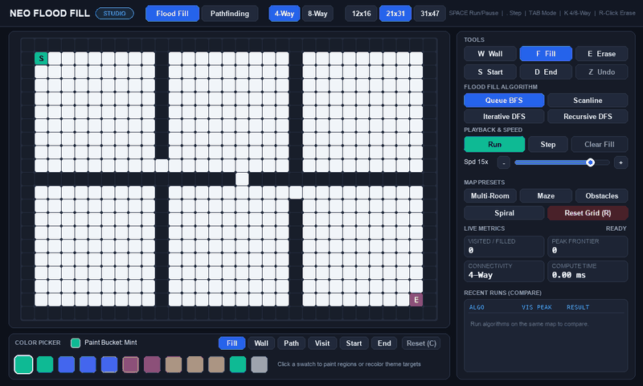
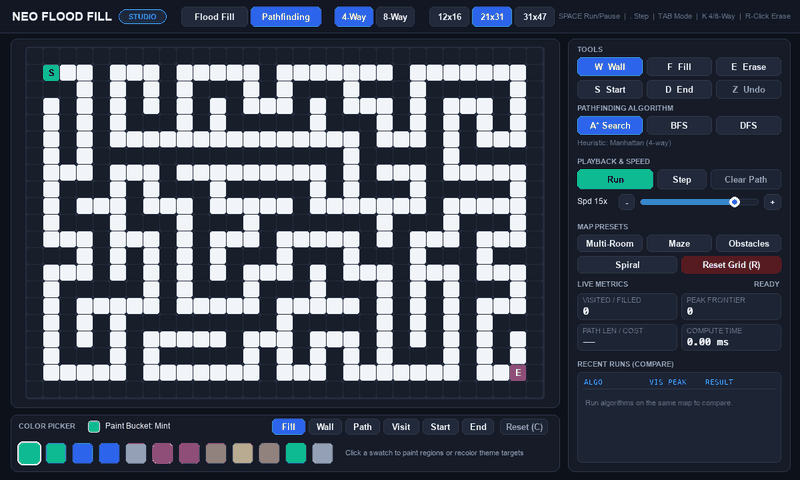
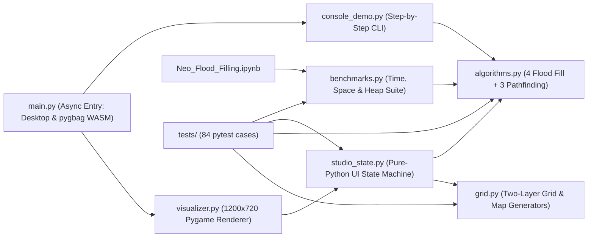
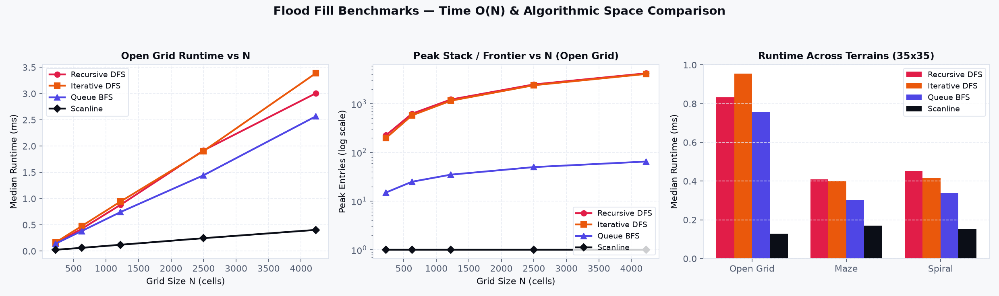
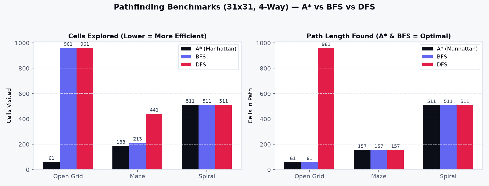

# Neo Flood Fill — Interactive Algorithm Studio

[](https://github.com/alejandronguyen1504/Neo-Flood-Filling-Game-/actions/workflows/ci.yml)
[](https://alejandronguyen1504.github.io/Neo-Flood-Filling-Game-/)


An interactive **Flood Fill & Pathfinding Algorithm Studio** built in Python & Pygame, compiled to **WebAssembly (`pygbag`)** for zero-install browser play, and paired with a scientific complexity benchmark suite and research notebook.

### **[Play Live in Your Browser (WebAssembly Demo)](https://alejandronguyen1504.github.io/Neo-Flood-Filling-Game-/)**

---

## Live Studio Preview

| Multi-Color Region Flood Fill (BFS, Scanline, Iterative DFS) | Shortest-Path Comparison (BFS vs A\* on Maze) |
|---|---|
|  |  |

---

## Key Features

### 1. Seven Core Graph & Grid Algorithms (4-Way & 8-Way)
- **Flood Fill (4 variants):**
  - **Queue-based BFS** — layer-by-layer wavefront expansion with $O(\sqrt{N})$ peak frontier on open square grids.
  - **Scanline (Span) Flood Fill** — sweeps maximal horizontal spans and seeds one coordinate per adjacent run, achieving **~6–8x faster runtime** and near-constant frontier size on open regions (supports both 4-way and 8-way diagonal padding).
  - **Iterative DFS** — explicit stack implementation immune to Python's call-stack recursion ceiling.
  - **Recursive DFS** — educational baseline with safe `target_color == fill_color` guard and graceful `RecursionError` capture.
- **Pathfinding (3 variants):**
  - **A\* Search** — admissible **Manhattan** heuristic (4-way, cost `1.0`) and **Octile** heuristic (8-way, diagonal cost $\sqrt{2}$).
  - **Breadth-First Search (BFS)** — guaranteed shortest unweighted path by hop count.
  - **Depth-First Search (DFS)** — non-optimal exploration baseline illustrating why DFS fails shortest-path guarantees.
- Every algorithm exposes **both** a synchronous API (returning structured `AlgorithmMetrics`) and a step-by-step Python generator (`*_steps` yielding atomic `StepEvent` frames) for non-blocking 60 FPS visualization.

### 2. Interactive Algorithm Studio (`1200×720`, Desktop & WebAssembly)
- **Two-Layer Grid Architecture:** Separates permanent terrain & multi-color Paint Bucket regions (`base`) from transient search visualizations (`overlay`: Frontier, Visited, Path, Start, End) — running or clearing pathfinding never destroys painted regions.
- **Smooth Interaction:** Click-and-drag wall drawing with **Bresenham line interpolation** (no skipped cells on fast strokes), right-click drag erase, hover coordinates, and 50-step Undo (`Z`).
- **Color Picker & Contrast Guard:** 12-color Paint Bucket palette + theme customizer (`Wall`, `Path`, `Visited`, `Start`, `End`) with real-time conflict warnings preventing unreadable color pairs.
- **Playback & Comparison:** 6 speed tiers (`0.5x` → `Max`), Pause/Resume (`SPACE`), Single-Step (`.`), 3 grid presets (`12×16`, `21×31`, `31×47`), 4 map generators (`Multi-Room`, `Maze`, `Obstacles`, `Spiral`), live pure-compute timing HUD, and a **Recent Runs Comparison** table on the same map.

---

## Architecture



### Repository Structure
```text
Neo-Flood-Filling-Game-/
├── main.py                              # Unified async entry point (Desktop, CLI --console, pygbag WASM)
├── pyproject.toml                       # Package metadata & pytest configuration
├── requirements.txt                     # Minimal runtime dependencies (pygame)
├── requirements-dev.txt                 # Dev, testing, plotting & web build deps
├── Neo_Flood_Filling.ipynb              # Executed research & matplotlib benchmark notebook
├── src/neo_flood_fill/
│   ├── grid.py                          # Two-layer Grid model, palette IDs, undo, Maze/Multi-Room/Spiral generators
│   ├── algorithms.py                    # Sync & generator Flood Fill (4) and Pathfinding (3) + AlgorithmMetrics
│   ├── studio_state.py                  # Display-independent Studio controller, Bresenham drag, conflict guard
│   ├── visualizer.py                    # Async 1200x720 Pygame Studio renderer (Desktop + WASM safe)
│   ├── benchmarks.py                    # Controlled O(N) runtime, algorithmic space & tracemalloc suite
│   └── console_demo.py                  # Non-blocking & interactive terminal step-by-step simulation
├── scripts/
│   ├── build_web.py                     # Stages pure-Python runtime into a ~31 KB pygbag WASM bundle
│   └── generate_assets.py               # Reproducibly regenerates GIFs, screenshots & matplotlib charts
├── tests/                               # 84 pytest unit, equivalence, motion & headless UI tests
├── docs/
│   ├── NCT-NEO-FloodFill.pdf            # Original RMIT NEO Culture Tech project specification
│   ├── Gantt Chart Flood fill research.pdf
│   └── assets/                          # Studio GIFs, screenshots & benchmark charts
└── .github/workflows/
    ├── ci.yml                           # Automated pytest matrix (Python 3.12 & 3.13) + pygbag build check
    └── deploy-web.yml                   # Auto-deploys WebAssembly Studio to GitHub Pages on push to main
```

---

## Complexity Analysis & Benchmarks

All measurements below were collected via `src/neo_flood_fill/benchmarks.py` (Python 3.13, 5-run median timings).

### Flood Fill Benchmarks (Open Grid, 4-Way)

| Algorithm | Time | Algorithmic Space (Open $n\times n$) | 20×20 ($N=400$) | 40×40 ($N=1600$) | 60×60 ($N=3600$) | Peak Space at 60×60 |
|---|---:|---:|---:|---:|---:|---:|
| **Scanline** | $O(N)$ | $O(1)$ open / $O(N)$ worst | `0.047 ms` | `0.159 ms` | **`0.345 ms`** | **`1` span** |
| **Queue BFS** | $O(N)$ | $O(\sqrt{N})$ open / $O(N)$ worst | `0.241 ms` | `0.971 ms` | `2.207 ms` | `60` cells |
| **Iterative DFS** | $O(N)$ | $O(N)$ explicit stack | `0.291 ms` | `1.253 ms` | `2.830 ms` | `3,482` cells |
| **Recursive DFS** | $O(N)$ | $O(N)$ call stack (overflow risk) | `0.250 ms` | `0.997 ms` | `2.649 ms` | `3,600` frames |



> **Engineering Note on CPython Space Measurement:** In v1, measuring space solely with `tracemalloc` produced misleading results where Recursive DFS appeared smaller than BFS (`0.01 KB` vs `1.34 KB`). In CPython 3.11+, interpreter call frames are allocated on a contiguous per-thread frame stack rather than per-call heap allocations tracked by `tracemalloc`. In v2, `benchmarks.py` explicitly separates **algorithmic space** (`peak_recursion_depth` vs `peak_frontier`) from **heap peak (`tracemalloc`)** measured on an isolated pass so tracing overhead never skews wall-clock runtime.

### Pathfinding Benchmarks (`31×31`, 4-Way)

| Terrain | Algorithm | Cells Visited | Peak Frontier | Path Length | Median Time | Optimal? |
|---|---|---:|---:|---:|---:|:---:|
| **Open Grid** | **A\* (Manhattan)** | **`61`** | `59` | **`61`** | **`0.153 ms`** | Yes |
| **Open Grid** | BFS | `961` | `31` | `61` | `1.367 ms` | Yes |
| **Open Grid** | DFS | `961` | `901` | `961` | `1.889 ms` | No |
| **Maze** | **A\* (Manhattan)** | **`188`** | `3` | **`157`** | `0.322 ms` | Yes |
| **Maze** | BFS | `213` | `4` | `157` | `0.310 ms` | Yes |
| **Maze** | DFS | `441` | `10` | `157` | `0.689 ms` | No (unique path) |
| **Spiral** | A\* / BFS / DFS | `511` | `1` | `511` | `~0.80 ms` | Forced corridor |



---

## Quick Start

### 1. Clone & Install
```bash
git clone https://github.com/alejandronguyen1504/Neo-Flood-Filling-Game-.git
cd Neo-Flood-Filling-Game-
python -m venv .venv
source .venv/bin/activate   # Windows: .venv\Scripts\activate
pip install -r requirements-dev.txt
pip install --no-deps -e .
```
*(Recommended: Python 3.12 or 3.13 for prebuilt `pygame 2.6.1` wheels.)*

### 2. Launch the Interactive Studio
```bash
python main.py
```

### 3. Run Console Simulation, Tests & WebAssembly Build
```bash
# Non-blocking CLI pathfinding / flood fill demo
python main.py --console --mode path --algo astar
python main.py --console --mode fill --algo scanline
python main.py --console --interactive

# Run the full 84-test pytest suite
pytest -v

# Build the lightweight (~38 KB APK) WebAssembly bundle locally
python scripts/build_web.py
```

### 4. Explore the Research Notebook
Open [Neo_Flood_Filling.ipynb](Neo_Flood_Filling.ipynb) in JupyterLab or VS Code and run all cells top-to-bottom for interactive algorithm walkthroughs and reproducible `matplotlib` charts.

---

## Studio Controls

| Input | Action |
|---|---|
| `Left Click / Drag` | Apply active tool (`Wall`, `Flood Fill`, `Erase`, `Start`, `End`) |
| `Right Click / Drag` | Quick erase cells anywhere on the grid |
| `W` / `F` / `E` / `S` / `D` | Select tool: Wall / Flood Fill / Erase / Start / End |
| `TAB` | Toggle between **Flood Fill** and **Pathfinding** mode |
| `K` | Toggle **4-Way** vs **8-Way** connectivity |
| `SPACE` | Run / Pause / Resume animation |
| `.` (Period) | Single-step animation while paused |
| `-` / `+` | Decrease / increase animation speed |
| `Z` / `X` / `R` / `C` | Undo / Clear fill or search overlay / Reset grid / Reset colors |
| `ESC` | Quit (Desktop) or stop active animation (Web) |

---

## Project Evolution & Contributions

- **v1 — Original Research Foundation (RMIT NEO Culture Tech):** Initiated as a 3-phase club research project ([spec](docs/NCT-NEO-FloodFill.pdf), [Gantt chart](docs/Gantt%20Chart%20Flood%20fill%20research.pdf)) implementing baseline recursive & queue-based flood fill, console step-by-step output, and an initial Pygame prototype in a shared Jupyter Notebook.
- **v2 — Independent Re-Architecture & Interactive Studio (`Quoc Anh Ngo Nguyen` / [@alejandronguyen1504](https://github.com/alejandronguyen1504)):**
  - Refactored the monolithic notebook into a modular Python package (`src/neo_flood_fill/`) with a two-layer grid model and decoupled UI state machine (`StudioState`).
  - Added Iterative DFS, 4/8-way Scanline Flood Fill, DFS & A\* (Manhattan/Octile) pathfinding, deterministic Maze/Multi-Room/Spiral generators, and fixed the `target_color == fill_color` infinite-loop bug and `tracemalloc` space-benchmarking flaw.
  - Built the `1200×720` async Pygame Interactive Algorithm Studio (true multi-color Paint Bucket Flood Fill, Bresenham drag painting, color-conflict guard, speed slider, single-step playback, live HUD, and Recent Runs comparison).
  - Engineered a 79-test `pytest` suite, reproducible `matplotlib` benchmark charts, GitHub Actions CI, and automated `pygbag` WebAssembly deployment to GitHub Pages.
